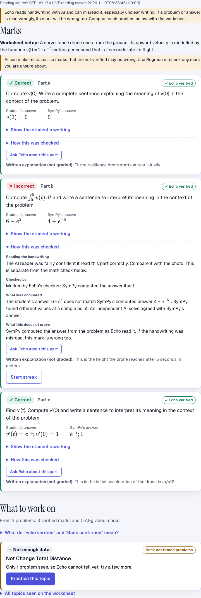
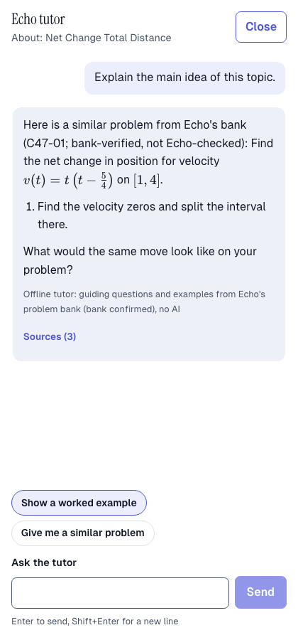
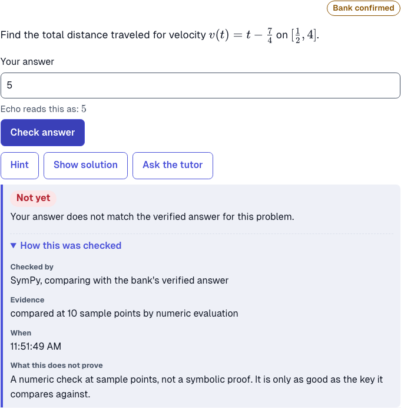

# Echo

Echo turns a photo of a finished calculus worksheet into targeted practice. It reads the photo, marks each final answer, shows which topics need work, and then coaches the student through new problems of the same kind. Every mark says how it was checked, and Echo never claims more than a program actually verified.

Scope: Calculus I and II. Built for the 2026-11-13 BetaFund hackathon.

## Try it yourself

You need Docker with Compose v2. From the top of this folder:

```bash
docker build -t echo-api .
docker build -t echo-ui ui
docker compose up -d --wait
```

Open http://localhost:3000. Stop with `docker compose down`. No API key is needed for the first run.

1. Choose **Settings** in the top bar and set **Where marks come from** to **Saved replay (works offline)**. Close Settings.
2. Upload `images/01-drone-mistake.jpeg` (drag it onto the dropzone) and click **Analyze worksheet**. Part (b) is marked **Incorrect**, with **Echo verified** beside it.
3. Click **Start streak** on part (b). Answer the first problem (click **Hint** if you are stuck), then get one wrong on purpose to see the streak reset. Each problem is labeled.
4. Click **Ask the tutor** and type "Explain how to find total distance".

Replay mode works only for photos with a saved reading: `01-drone-mistake.jpeg`, `03-implicit-curve.jpeg`, `04-edge-cases-clear.jpeg`, `07-parametric-stray-work.jpeg`, and `08-greek-exam-not-math.jpeg`, all in `images/`. For any other photo, choose **Scripted demo data**: it needs no key and gives scripted marks, not a real reading.

**Live AI** reads and grades any photo with a model. It needs internet and your own `ANTHROPIC_API_KEY` in an untracked `.env` file (see `.env.example`).

Without Docker, the page runs alone with scripted data:

```bash
cd ui && npm ci && NEXT_PUBLIC_FIXTURES=1 npm run dev
```

## The idea in one paragraph

Most AI tutors sound equally sure whether they computed an answer or guessed it. Echo keeps those apart. A math program (SymPy) computes or checks what it can, and those marks are labeled as checked. Anything an AI had to judge on its own is labeled that way, and the tutor is told the difference: it will not tell a student they are wrong unless a program confirmed it. When Echo cannot tell, it says so and asks the student to check a step with it.

## Screenshots

Saved replay of a real photo (the drone worksheet), at 1440 pixels wide. Light and dark themes are the same layout.

| The marks | The tutor | A checked answer |
|---|---|---|
|  |  |  |

Dark theme: [marks](docs/screens/results-dark.png), [tutor](docs/screens/tutor-dark.png), [checked answer](docs/screens/practice-check-dark.png).

## How a mark is made

The reading step separates each question, the student's final answer, and any setup shared by several parts. The page shows the reading beside the marks. Every mark carries a method label.

| Route | What happens | Label on the mark |
|---|---|---|
| Low confidence read | If the reader flags a part as unclear, live and fake grading leave it unsure. | Not marked |
| Bank match | The question matches an audited bank problem. SymPy compares the student's answer with its verified key. | Verified bank answer |
| SymPy computation | SymPy computes a reference answer for a supported derivative, limit, value, definite or indefinite integral, tangent line, equation, or solution set, then compares. | Echo's checker computed the answer |
| AI ladder | When SymPy cannot compute the answer, two models solve the question without seeing the student's answer, and a third breaks a disagreement. SymPy may compare the answers, but it does not verify the AI's answer. | AI graded; not verified by Echo |
| AI judge | When the answer cannot be compared as math, a model judges it. | AI judgment only |

A blind AI solve also cross-checks a computed SymPy answer. Agreement confirms it; disagreement makes the mark unsure. It never flips a verdict. **Regrade** re-runs AI marking in live mode; replay and fake mode keep the existing mark. Each unsure mark says why: the reading, the form of the answer, a disagreement between solves, a missing AI answer, or a known rule such as a missing `+ C`.

The skill picture counts marks per topic. Recommendations put weak topics first, then shaky ones, then topics with too little data.

## Verified is not the same as correct

Each mark records two separate things: what was found (correct, incorrect, unsure) and whether a program verified it. A mark that was not verified is never treated as confirmed wrong. This is enforced in one place, `core/evidence.py`, which turns a mark into the stance the tutor may take: confirmed, likely, or not known. An AI-only "incorrect" is "not known" to the tutor.

## Practice and the tutor

- **Practice.** The student types an answer and Echo checks it against the bank's verified key at sample points. Hints reveal the bank's worked steps one at a time, and the key stays hidden until the problem is solved. Each check shows who checked it, the evidence, the time, and what the check does not prove. A check that cannot read the answer says "Unable to verify", never "wrong".
- **The tutor** answers from worked examples in Echo's bank (BM25 retrieval with topic filters) and cites the ids it used. It teaches Socratically: the first reply is a focused question, then a more specific hint, then the next step, then a full worked solution. A request for the solution or an example gets it straight away; so does being stuck for five rounds. A tutor reply that uses grading vocabulary, or comes back empty or malformed, is replaced by guided questions from the bank. If the model service is down, the student sees a plain message and Retry.
- **Ask Echo** on any marked part helps the student check their work. It is read-only: it never changes a mark.
- **Streak.** After a wrong or unsure part, the tutor offers a streak: a progress bar of correct answers in a row on the same concept. Each answer is checked against the bank's verified key. A wrong answer resets the bar; using the solution ends the streak. The length (3 to 6, default 5) is set in **Settings**, next to the theme and the marks source. If only a few different problems exist, the streak is shortened and says so.
- Problem difficulty levels are never shown to the student.

Echo-checked practice problems are generated ahead of time for chain rule, quotient rule, and net change / total distance (118 problems in all). A model proposes an answer, writes a problem for it, and SymPy verifies that problem before it is saved (`scripts/generate_echo_problems.py`, see `docs/generated-problems.md`). Each problem is labeled **"Echo-checked: key verified by the checker"**. Other topics serve audited bank problems labeled **"bank-verified, not Echo-checked"**.

## Running it

Docker with Compose v2 runs the API at `http://127.0.0.1:8000` and the page at `http://localhost:3000`. From this folder:

```bash
docker build -t echo-api .
docker build -t echo-ui ui
docker compose up -d --wait
```

Open http://localhost:3000. Stop with `docker compose down`. The API build runs the `power_rule` gate. Both published ports bind to `127.0.0.1`.

On the page, choose **Live AI**, **Saved replay**, or **Scripted demo data**. Live needs internet and `ANTHROPIC_API_KEY` in the environment or an untracked `.env` file (see `.env.example`). Replay plays back a saved run and needs a saved reading for that exact photo. Scripted data needs no key and no model.

To work on the page alone, with fake data and no API:

```bash
cd ui && npm ci && NEXT_PUBLIC_FIXTURES=1 npm run dev
```

(PowerShell: set `$env:NEXT_PUBLIC_FIXTURES = "1"` first.)

## Tests

As of 2026-11-13: backend `pytest` 1607 passed, 9 skipped; browser `cd ui && npx playwright test` 143 passed. Install backend test tools with `pip install -r requirements-dev.txt`.

## What to be honest about

- AI marks can be wrong. SymPy comparing a student's answer with an AI answer does not verify the AI answer.
- A misread question or answer can produce a wrong mark and a misleading skill picture. The reader may split working and final answers differently on another run. The page shows the reading, and a student can correct it by typing or speaking, then confirm before anything is graded.
- Parametric curves, graphs, tables and written explanations have no computed route here. They fall to AI judgment and are labeled that way. Written explanations are shown but not graded. For these, the tutor asks the student to check a step rather than judging.
- A rounded decimal for an exact answer (for example 1.718 for e - 1) can still be marked incorrect by the AI route. This is a known gap.
- The offline tutor only has the bank example's steps to draw on. Live replies are not limited that way.
- The API has no login and trusts the marks the page sends it. That is acceptable only for the local demo, where it is bound to localhost and checks Host, Origin on writes, and request size. Do not expose it publicly.
- Voice input uses your browser's speech recognition. Chrome and Edge may send audio to the browser vendor; it never reaches Echo's server, and typing works without it.
- Upload code strips image metadata, including location, before reading. Photo bytes stay in memory and are not saved. Saved replays hold readings and marks only.

## Where the code came from

Echo's code was prepared before the event; the organizer approved writing code beforehand. The checking code in `app/` is reused from the author's earlier AI math tutor. The worksheet reading and grading (`core/`), the page (`ui/`), the API (`server/`), and the tutor are Echo's own. The problem bank (3,510 problems in 90 topics, of which 3,405 pass the audit) is pre-built and audited by `scripts/audit_bank.py`.

## More

[Progress](docs/progress.md), [decisions](docs/decisions.md), [known issues](docs/known-issues.md), [demo script](docs/demo-script.md), and [the grading review](docs/review-grading.md).

## Problem bank analysis

See [the English analysis notebook](analysis/Echo_Bank_Analysis.ipynb) and
[analysis setup and results](analysis/README.md) for reproducible topic/level
coverage, duplicate review candidates, and constructed power-rule negative tests.
This read-only analysis retains the existing difficulty ratings and does not
change the bank, grading, or practice-generation behavior.

## Experimental level guesser

See [Level Guesser documentation and measured limitations](levels/README.md) and
[the executed English evaluation notebook](levels/Echo_Level_Guesser_Evaluation.ipynb).
This five-neighbor baseline estimates difficulty from bank ratings using source-structure
proxies. It is not connected to drafting, does not verify answers, and is not ready
as a reliable automatic difficulty gate. Reproduce with `python scripts/evaluate_levels.py`.
